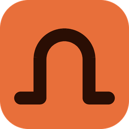
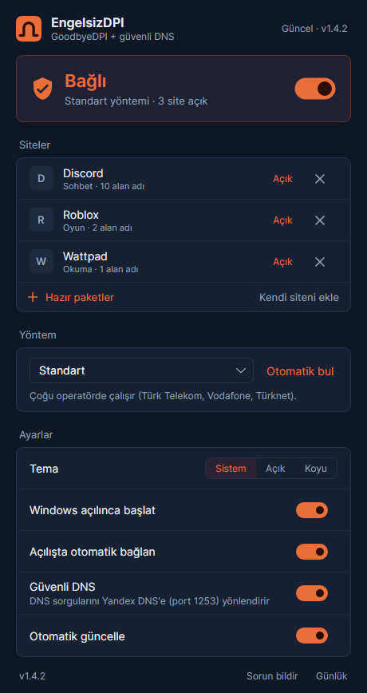
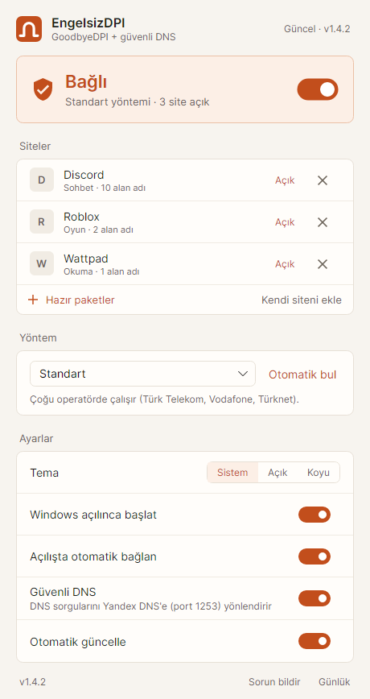
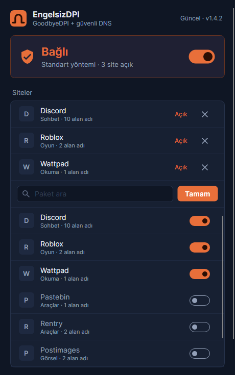

<p align="center">
  
</p>

<h1 align="center">EngelsizDPI</h1>

<p align="center">
  Discord, Roblox ve erişime kapatılan diğer sitelere <b>VPN kullanmadan</b>, internetinizi yavaşlatmadan erişin.
</p>

<p align="center">
  <a href="https://github.com/Claymore222/EngelsizDPI/releases/latest"></a>
  <a href="https://github.com/Claymore222/EngelsizDPI/releases"></a>
  
  <a href="LICENSE"></a>
</p>

<p align="center">
  <a href="https://github.com/Claymore222/EngelsizDPI/releases/latest/download/EngelsizDPI.exe"><b>EngelsizDPI.exe'yi indir</b></a>
  &nbsp;·&nbsp;
  <a href="#kurulum">Kurulum</a>
  &nbsp;·&nbsp;
  <a href="#sık-sorulanlar">Sık sorulanlar</a>
</p>

<p align="center">
  
  &nbsp;
  
</p>

---

EngelsizDPI, sistem tepsisinde sessizce çalışan küçük bir Windows uygulamasıdır. Arka planda açık kaynaklı
[GoodbyeDPI](https://github.com/ValdikSS/GoodbyeDPI) motorunu ve güvenli bir DNS yönlendirmesini kullanır. Siyah
komut pencereleri, `.cmd` dosyaları ya da elle ayar yok: bir kez kurarsınız, Windows her açıldığında kendiliğinden
devreye girer.

## Neler yapıyor?

- **Tek düğme.** Büyük anahtara basın; uygulama bağlanır ve sitelerin gerçekten açıldığını kendisi test eder.
- **Operatörünüze kendini uydurur.** Varsayılan yöntem sizin hattınızda çalışmazsa ilk bağlantıda bütün yöntemleri
  sırayla dener ve çalışanı seçer. Türk Telekom, Superonline, Vodafone ve Türknet için yöntemler hazır.
- **Kendini kontrol eder.** Bağlıyken siteleri arada bir, ağ değişince ve bilgisayar uykudan uyanınca yeniden
  test eder; kapanan olursa kendiliğinden yeniden bağlanır.
- **Yalnızca seçtiğiniz siteler.** Engel aşma sadece listedeki sitelere uygulanır. Oyunlarınız, bankanız ve diğer
  uygulamalar hiç etkilenmez.
- **Hazır paketler.** Discord ve Roblox hazır gelir; Wattpad, Pastebin ve diğerlerini tek dokunuşla açarsınız.
  Liste uygulama güncellenmeden internetten yenilenir.
- **Güvenli DNS.** DNS sorguları operatörün araya giremediği Yandex DNS'e yönlendirilir. Windows DNS ayarlarınıza
  dokunulmaz; sunucuya ulaşılamazsa internetiniz kesilmesin diye normal DNS'e geçilir.
- **Sistemi kirletmez.** Kalıcı bir servis kurulmaz. Uygulamadan çıktığınızda her şey eski hâline döner.
- **Kendini günceller.** Yeni sürümü haber verir; siz *Şimdi yükle* deyince ya da uygulama bir sonraki açılışında
  kurulur. Çalışırken sizden habersiz yeniden başlamaz.
- **Açık ve koyu tema**, Windows ayarınıza uyar.

## Kurulum

1. **[EngelsizDPI.exe](https://github.com/Claymore222/EngelsizDPI/releases/latest/download/EngelsizDPI.exe)**
   dosyasını indirin ve çift tıklayın.
2. Windows "bilgisayarınızı korudu" uyarısı gösterirse **Ek bilgi** → **Yine de çalıştır** deyin. Uygulama
   imzasız olduğu için bu uyarı yalnızca ilk seferde çıkar.
3. Yönetici izni sorulduğunda **Evet** deyin. Bu izin yalnızca ilk kurulumda bir kez sorulur.

EngelsizDPI kendini `C:\Program Files\EngelsizDPI` klasörüne kurar, Başlat menüsüne ve masaüstüne kısayol ekler
ve açılır. İndirdiğiniz dosyayı silebilirsiniz. Ortadaki anahtara basmanız yeterli.

**Kaldırmak için:** Ayarlar → Uygulamalar → Yüklü uygulamalar → EngelsizDPI → Kaldır.

> [!NOTE]
> Bazı antivirüs programları (özellikle Kaspersky) ağ paketlerini değiştiren WinDivert sürücüsü yüzünden yanlış
> alarm verebilir. Böyle bir durumda `C:\Program Files\EngelsizDPI` klasörünü antivirüs istisnalarına ekleyin.

## Kullanım

<p align="center">
  
</p>

- **Hazır paketler:** Site listesinin altındaki düğme bütün paketleri açar. İstediğinizi açın, *Tamam* deyin.
- **Kendi siteni ekle:** Alan adını yazın (ör. `ornek.com`). Uygulama o sitenin kullandığı diğer adresleri
  (resim ve dosya sunucuları) tarar ve engelli olanları önerir. *Herkese öner* ile siteyi herkesin listesine
  eklenmesi için önerebilirsiniz.
- **Yöntem ve Otomatik bul:** Bir site açılmazsa *Otomatik bul*'a basın; bütün yöntemleri dener.
- **Sorun bildir:** Alttaki düğme GitHub'da, uygulamanın durumuyla doldurulmuş bir form açar. Ne olduğunu yazıp
  gönderin. Eklediğiniz sitelerin adları forma yazılmaz.

## Nasıl çalışır?

Operatörler engelli siteleri, bağlantının başında açık metin olarak giden site adına (SNI) bakarak tespit eder
ve bağlantıyı keser. Buna DPI (derin paket incelemesi) denir. EngelsizDPI, GoodbyeDPI motoruyla bu ilk paketleri
böler ve engelleme cihazını yanıltan sahte paketler gönderir; site adı fark edilmez. Trafik başka bir sunucudan
geçmediği için VPN'deki gibi hız kaybı olmaz.

Bazı operatörler DNS'e de araya girip engelli sitelere yanlış adres verir. Bu yüzden DNS sorguları, operatörün
ele geçirmediği standart dışı bir porta (Yandex DNS, 1253) yönlendirilir.

| Yöntem | GoodbyeDPI parametreleri | Ne zaman |
|---|---|---|
| Standart | `-5 --set-ttl 5` | Çoğu operatör |
| Alternatif 1 | `--set-ttl 3` | Superonline |
| Alternatif 2 | `-5` | Bazı siteler yavaş açılıyorsa |
| Alternatif 3 | `-9` | Superonline fiber |
| Alternatif 4 | `-7` | Diğerleri çalışmazsa |

Ayrıntılı teknik anlatım: [docs/MIMARI.md](docs/MIMARI.md).

## Sık sorulanlar

<details>
<summary><b>VPN'den farkı ne?</b></summary>

VPN bütün trafiğinizi başka bir ülkedeki sunucudan geçirir; yavaşlar, oyunlarda ping artar ve çoğu ücretlidir.
EngelsizDPI trafiğinizi hiçbir yere göndermez, yalnızca seçtiğiniz sitelere giden ilk paketlerin şeklini
değiştirir. Hız ve ping aynı kalır.
</details>

<details>
<summary><b>Bir site açılmıyor.</b></summary>

Önce *Otomatik bul*'a basın. Yine açılmıyorsa site adresinden (IP'den) engellenmiş olabilir; bu durumda yalnızca
VPN açar. Emin değilseniz *Sorun bildir* ile bildirin.
</details>

<details>
<summary><b>Discord tarayıcıda açılıyor ama uygulaması açılmıyor.</b></summary>

Discord'u tepsiden de tamamen kapatıp yeniden açın. Olmazsa *Otomatik bul*'u deneyin.
</details>

<details>
<summary><b>"GoodbyeDPI hemen kapandı" ya da "WinDivert" hatası alıyorum.</b></summary>

Genellikle bir antivirüs WinDivert'i engelliyor ya da başka bir DPI aracı (eski GoodbyeDPI, DNSChanger) çalışıyor
demektir. Uygulama eski araçları fark edip *Düzelt* düğmesi gösterir. Antivirüs için yukarıdaki nota bakın.
</details>

<details>
<summary><b>Bilgisayarımda ne değişiyor? Güvenli mi?</b></summary>

Kalıcı servis kurulmaz, Windows DNS ayarlarına dokunulmaz. Uygulama yalnızca `C:\Program Files\EngelsizDPI`
klasörünü, bir zamanlanmış görevi ve Başlat menüsü kısayolunu oluşturur; kaldırınca hepsi silinir. Hiçbir hesap
ya da kişisel veri istemez ve göndermez. Güncellemeler yalnızca bu depodan indirilir ve doğrulanır. Ayrıntılar:
[SECURITY.md](SECURITY.md).
</details>

<details>
<summary><b>Ayarlarım nerede saklanıyor?</b></summary>

`%AppData%\EngelsizDPI\settings.json`. Sorun giderme günlüğü `C:\ProgramData\EngelsizDPI\logs` klasöründedir;
uygulamadaki *Günlük* düğmesi açar.
</details>

## Site önermek

Hazır site listesi bu depodaki [`packs/packs.json`](packs/packs.json) dosyasıdır ve uygulama güncellenmeden,
birkaç saat içinde herkese ulaşır. Yeni bir site önermek için uygulamada siteyi ekleyip *Herkese öner*'e basın ya
da [öneri formunu](https://github.com/Claymore222/EngelsizDPI/issues/new?template=site-onerisi.yml) doldurun.

<details>
<summary>packs.json biçimi</summary>

```json
{ "id": "discord", "name": "Discord", "category": "Sohbet", "default": true,
  "test": "https://discord.com/api/v9/gateway",
  "domains": ["discord.com", "discord.gg", "discordapp.com"] }
```

Listeyi değiştirdiğinizde en üstteki `revision` sayısını bir artırın; uygulamalar yalnızca daha yeni revizyonu
indirir. Alan adları alt alan adlarını da kapsar (`discord.com` → `cdn.discord.com`). Test adresi paketin kendi
alan adlarından birinde olmalıdır.
</details>

## Geliştirme

<details>
<summary>Derleme, test ve yayın</summary>

.NET 10 SDK gerekir.

```bash
dotnet build src/EngelsizDPI
dotnet test --project tests/EngelsizDPI.Tests
dotnet run --project tools/Screenshot -- ./ekran-goruntuleri   # yönetici gerekmez
dotnet publish src/EngelsizDPI -c Release -r win-x64 -o publish   # tek dosya exe
```

Yeni sürüm için `vX.Y.Z` biçiminde bir etiket göndermek yeterli. GitHub Actions testleri çalıştırır, exe'yi ve
`EngelsizDPI.exe.sha256` dosyasını derleyip Releases sayfasına yükler.

Projeye başlamadan önce [docs/MIMARI.md](docs/MIMARI.md) (nasıl çalışıyor) ve
[docs/SORUN-GIDERME.md](docs/SORUN-GIDERME.md) (olası sorunlar ve çözümleri) okunmalı.
</details>

## Lisans ve teşekkür

[Apache-2.0](LICENSE). EngelsizDPI şu projelere dayanır:
[GoodbyeDPI](https://github.com/ValdikSS/GoodbyeDPI) (ValdikSS),
[GoodbyeDPI-Turkey](https://github.com/cagritaskn/GoodbyeDPI-Turkey) (cagritaskn) ve
[WinDivert](https://github.com/basil00/WinDivert) (basil00). Ayrıntılar:
[THIRD-PARTY-NOTICES.md](THIRD-PARTY-NOTICES.md).

<sub>Bu yazılım bilgiye erişim özgürlüğü amacıyla geliştirilmiştir. Kullanımından doğan sorumluluk kullanıcıya
aittir.</sub>
